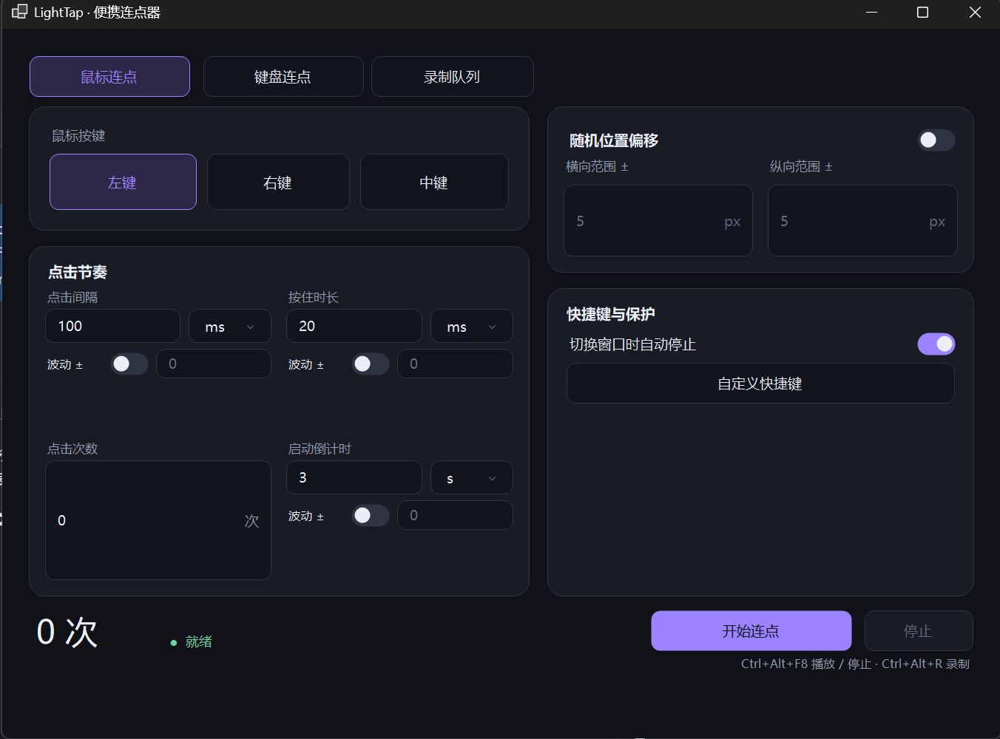

# LightTap

重复造轮子之连点器 。



## 功能介绍

- **鼠标连点**：选择左键、右键或中键，设置点击间隔、按住时长、点击次数和启动倒计时。
- **键盘连点**：选择要重复触发的按键，并设置间隔、按住时长和次数。
- **节奏与位置控制**：点击间隔、按住时长和倒计时可设置随机波动；鼠标连点可启用随机位置偏移，点击后回到原位置。
- **键鼠录制**：录制键盘按下/释放、鼠标按键、滚轮和移动轨迹。录制自动保存在应用内录制库，可改名、删除，也可手动导入或导出 `.kkrec` 文件。
- **队列回放**：将录制加入队列并调整顺序，设置片段间隔、循环次数和循环间隔。片段之间会自动移动鼠标到下一段起点，也可启用移动路径扰动。
- **快捷键控制**：播放快捷键可在应用内设置；录制快捷键默认为 **Ctrl+Alt+R**。回放时窗口隐藏，完成或停止后恢复。

## 下载和运行

从 [GitHub Releases](https://github.com/Teriss/LightTap/releases/latest) 下载 `LightTap.exe` 后双击运行。设置和录制库保存在 EXE 同目录的 `LightTapData` 文件夹。

## 从源码构建

安装 .NET 10 SDK 后，在 Windows PowerShell 中运行：

```powershell
.\build.ps1
```

生成的单文件位于 `dist/win-x64/LightTap.exe`。
